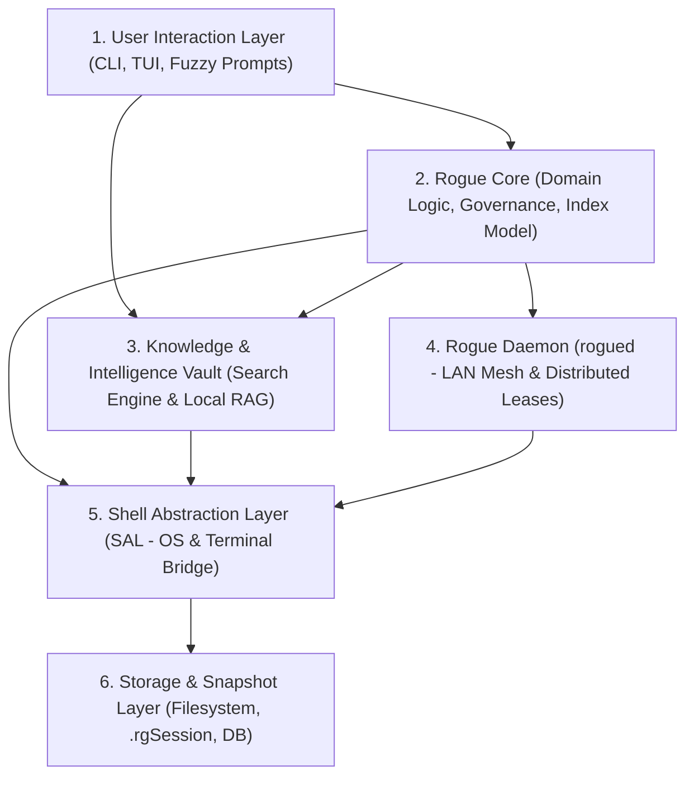

# RoguePM Architecture Overview

A modular, multi-platform project management and distributed workbench system.

---

## Architecture Layers

---

## 1. User Interaction Layer (Frontend / CLI)
Captures developer input and renders formatted output. Completely decoupled from OS-specific logic.

- **Command Dispatcher:** Parses subcommands (`new`, `open`, `list`, `doc`, `ask`) and CLI arguments.
- **Fuzzy Selectors:** Prompts the user through interactive selection tools (`fzf`, `bemenu`, or basic terminal menus).
- **Output Presentation:** Formats colored logs, aligned lists, and clean terminal status banners.

---

## 2. Rogue Core (Domain Logic & Governance)
The platform-agnostic brain containing all business rules, structures, and lifecycle workflows.

- **Index & Node Model:** Maps logical indices where `0` is the local node and non-zero indices are remote peers.
- **Organization Hierarchy:**
  - *Profiles:* High-level identity boundaries (e.g., `personal`, `work`, `lab`) with GitHub profile mappings.
  - *Intents:* Functional engineering domains (e.g., `embedded`, `systems`, `gamedev`).
  - *Projects:* Recursive unit of work supporting nested sub-projects and metadata tracking.
- **Concurrency Guard (`rg.lock`):** Manages project lock states to guarantee only one workbench across the network writes to a project at a time.
- **Source Pointer Engine:** Decouples physical disk locations from logical tree positions (absolute roots vs. relative sub-paths).
- **Template Engine:** Ingests scaffold templates and performs file and variable substitutions.
- **Native Git Integration:** Uses `libgit2` to inspect repository states without shell overhead.

---

## 3. Knowledge & Intelligence Vault (Reference & Local RAG)
A dedicated intelligence subsystem that manages reference materials and context retrieval without contaminating project git repositories.

### Where it sits:
Positioned as a **sibling subsystem alongside Rogue Core and Rogue Daemon**. It is queried directly by the CLI for research/lookups and by Core to supply context during project work.

### Core Components:
- **Reference Vault:**
  - Stores non-code project references: datasheets, pinout charts, hardware diagrams, architecture notes, and POSIX/Vulkan specs.
  - Kept strictly outside project repositories and `.gitignore`.
- **Local Search Engine:**
  - Ingests and indexes documents on the local machine.
  - Provides fast local text retrieval using hybrid keyword (BM25) and lexical matching.
- **Local RAG (Retrieval-Augmented Generation):**
  - Chunking and local embedding generation for indexed documentation.
  - Vector similarity search running completely on-device.
  - Injects relevant documentation snippets into prompts for local LLMs (e.g., llama.cpp, Ollama, or small on-device models).
  - Powers commands like `rogue ask <query>` or project-aware LLM context generation (`rogue ai context`).

---

## 4. Rogue Daemon (`rogued` - Mesh & P2P Layer)
The background daemon that connects autonomous nodes into a distributed network.

- **LAN Discovery:** Automatically finds active peers using zero-configuration mDNS (`_rogued._tcp.local.`).
- **Peer Identity & Trust:** Maintains unique machine UIDs, pairing workflows, and cryptographic keys.
- **Distributed Lease Protocol:** Negotiates and grants remote project locks before peers mount code over the network.
- **Transport Setup:** Establishes on-demand TCP streams or SSH/SSHFS tunnels between nodes.
- **Local IPC Control:** Listens on a local control socket for commands issued by Rogue Core and the CLI.

---

## 5. Platform & Shell Abstraction Layer (SAL)
The single boundary that isolates all operating system and shell differences. Core and Vault never run raw OS commands directly.

- **Session & Terminal Runner:**
  - Spawns and configures `tmux` windows and split panes on Linux, macOS, and Termux.
  - Spawns Windows Terminal (`wt.exe`) tabs, PowerShell panes, or ConPTY on Windows.
- **Filesystem & Link Bridge:**
  - Creates POSIX symlinks (`ln -s`) on Linux/macOS/Termux.
  - Creates directory junctions (`mklink /J`) or fallbacks on Windows.
  - Resolves platform directories: Linux XDG (`~/.config/rogue`), macOS (`~/Library/Application Support`), Windows (`%APPDATA%\rogue`).
- **Process Execution Bridge:**
  - Dispatches binaries with structured argument arrays (`[binary, arg1, arg2]`) instead of invoking raw shell command strings.
- **IPC Transport Bridge:**
  - Bridges UNIX domain sockets on POSIX with Named Pipes or local loopback TCP sockets on Windows.

---

## 6. Storage & Snapshot Layer
Underlying persistent storage engines used across the system.

- **`.rgSession`:** Serialized binary snapshots of active workspace states, opened tools, and pane layouts.
- **Daemon Database:** Embedded key-value database (such as Sled) to persist peer rosters, trust keys, and lease records.
- **Knowledge Embeddings & Index Store:** Local vector and lexical index storage for fast offline RAG lookups.
